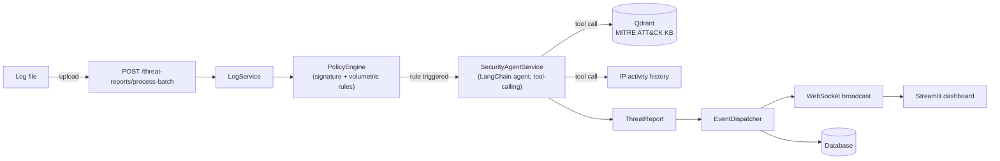

<div align="center">

# 🛡️ LogAssistant — AI-Powered Network Threat Analysis

**Upload raw network logs. Get structured, AI-generated threat reports in real time.**


</div>

---

## What it does

LogAssistant ingests raw network/access logs, runs them through a configurable **rule engine** (signature + volumetric detection rules), and — when a rule is triggered — hands the suspicious activity off to an **LLM security agent** that investigates it using real tools (a MITRE ATT&CK knowledge base and IP activity history), then produces a structured threat report: type, severity, mitigation plan, and recommendations. Reports are persisted and broadcast live over WebSocket to a Streamlit dashboard.

It's a small end-to-end system that combines a few things that are individually common but rarely wired together in a portfolio project: rule-based detection, an LLM agent with tool-calling and retrieval, async persistence, machine-to-machine auth, and a real-time frontend — backed by a test suite (unit + integration, ~87% coverage) that mocks the LLM and vector store instead of hitting them for real.

## Architecture



Batch analysis (`/process-batch`) is machine-to-machine only, protected by a JWT obtained via an OAuth2 **client_credentials** flow (`/auth/token`) — not the usual username/password grant, since there's no human user on that side, only a trusted log-shipping client.

## Features

- **Configurable rule engine** — signature-based and volumetric (rate-based) detection rules, defined in a JSON policy file, validated with Pydantic on load.
- **LLM security agent** — a LangChain tool-calling agent (Claude) that investigates a triggered rule using a MITRE ATT&CK knowledge base (Qdrant + HuggingFace embeddings) and IP activity history, and returns a structured, schema-validated threat report.
- **Machine-to-machine auth** — OAuth2 `client_credentials` grant with a JWT, purpose-built for service-to-service calls instead of the more common (and here, wrong) resource-owner password grant.
- **Real-time alerts** — new threat reports are broadcast over WebSocket to a Streamlit dashboard as they're generated.
- **Async persistence** — SQLAlchemy 2.0 async ORM.
- **Structured logging** — `structlog`, JSON in production / readable console output in development.
- **Test suite** — unit tests for the rule engine, schemas, and services; the LLM and vector store are mocked rather than called for real, so the suite is fast and deterministic.

## Tech stack

**Backend:** FastAPI, LangChain (Anthropic Claude), Qdrant, HuggingFace embeddings, SQLAlchemy (async), Pydantic v2, structlog, PyJWT
**Frontend:** Streamlit, WebSocket client
**Testing:** pytest, pytest-cov, anyio
**Infra:** Docker Compose (backend + frontend + Qdrant)

## Quick start

```bash
git clone https://github.com/dozoq/AILogAssistant.git
cd AILogAssistant
cp .env.example .env   # fill in the values, see Configuration below
docker compose up --build
```

- Backend API: `http://localhost:8000`
- Frontend dashboard: `http://localhost:8080`
- Qdrant: `http://localhost:6333`

## Configuration

| Variable | Used by | Description |
|---|---|---|
| `ANTHROPIC_API_KEY` | backend | Claude API key for the security agent |
| `JWT_SECRET_KEY` | backend | Signs/verifies the M2M access tokens |
| `INTERNAL_CLIENT_SECRET` | backend | Shared secret trusted clients authenticate with |
| `QDRANT_URL` | backend | Qdrant endpoint (`http://qdrant:6333` inside Docker) |
| `DATABASE_URL` | backend | Optional — defaults to a local SQLite file |

## Testing

```bash
cd LogAssistant
uv run pytest --cov=src/logassistant --cov-report=term-missing
```

The suite covers the rule engine (including edge cases like threshold arithmetic and regex targeting), Pydantic schema validation, the auth flow, and the LLM agent's orchestration loop — the agent's `ainvoke` calls are mocked with canned `AIMessage` responses, so tests run without live API calls or a running Qdrant instance.

## API testing

A [Bruno](https://www.usebruno.com/) collection is included under `bruno/` with example requests for every endpoint.

## Project structure

```
LogAssistant/          FastAPI backend
LogAssistantFrontend/  Streamlit dashboard
bruno/                 API request collection
docker-compose.yaml    Backend + frontend + Qdrant
```
